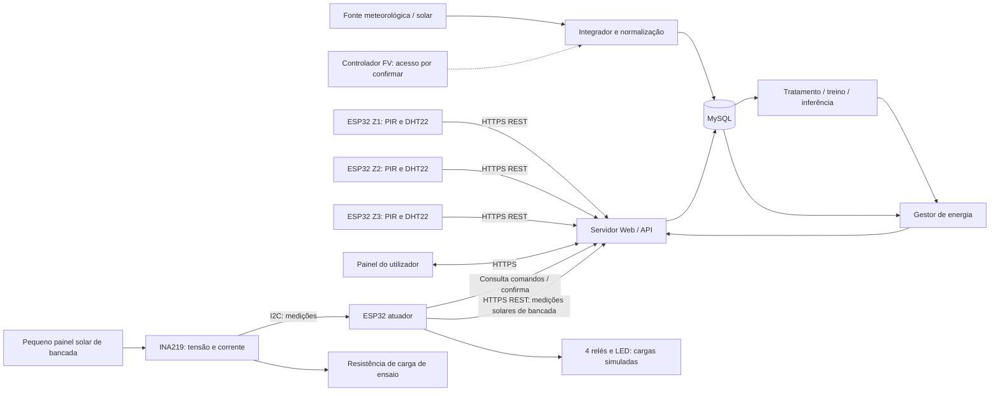
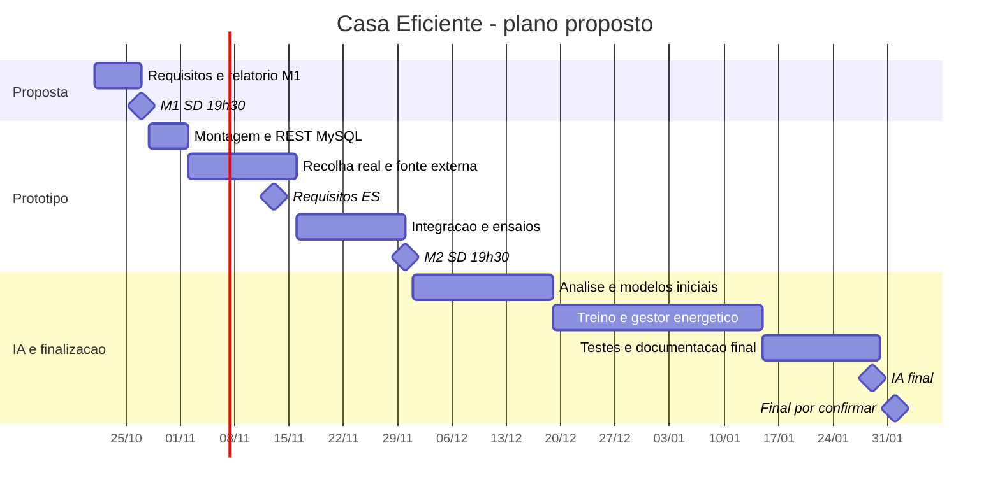

# Casa Eficiente
## Milestone 1 — Proposta inicial do projeto

| Identificação | Informação |
|---|---|
| Universidade | Universidade Europeia |
| Faculdade | Engenharia de Informática |
| Curso | Licenciatura em Engenharia Informática — online |
| Ano letivo / semestre | 2026–2027 / 5.º semestre |
| Unidades curriculares | Sistemas Distribuídos; Computação Física e IoT; Inteligência Artificial; Engenharia de Software |
| Projeto | Casa Eficiente |
| Grupo | **Preencher antes da entrega** |
| Repositório público GitHub | https://github.com/Rafael16r/energia_solar|
| Entrega e apresentação — Milestone 1 | **27/10/2026, às 19:30** |
| Briefing de referência | «Recolha e Tratamento de dados de sensores IoT», v1-20261020 |

### Elementos do grupo

| Número de estudante | Nome |
|---|---|
| 20241964 | João Pedro Benge do Espírito Santo Vieira |
| 20241781 | Nelson Rafael Soares Moreira |
| 20241204 | Rafael Ibraim Resende |
| 20241323 | Iaia Baldé |

**Palavras-chave:** gestão energética residencial; casa sustentável; ESP32; IoT; energia solar; ocupação; inteligência artificial.

**Resumo.** Propomos um sistema distribuído de gestão energética para uma moradia T3. Três nós ESP32 recolherão movimento, temperatura e humidade em três zonas reais durante 7 a 14 dias. Um servidor Web receberá os dados por REST e guardá-los-á em MySQL, cruzando-os com uma fonte solar/meteorológica adicional. Um pequeno painel fotovoltaico de bancada, associado a um módulo INA219, permitirá medir tensão, corrente e potência numa demonstração à escala. A componente de IA analisará padrões de ocupação e apoiará a estimativa de consumo. Um gestor proporá horários de climatização por divisão e de funcionamento da bomba da piscina. As cargas serão simuladas por relés e LED de baixa tensão. Esta entrega define o problema, os requisitos, a arquitetura, o protótipo, os testes e o plano de trabalho; não apresenta medições, modelos treinados ou poupanças verificadas.

### Índice

1. [Identificação e enquadramento](#1-identificação-e-enquadramento)
2. [Problema, objetivos e âmbito](#2-problema-objetivos-e-âmbito)
3. [Requisitos e critérios de aceitação](#3-requisitos-e-critérios-de-aceitação)
4. [Descrição do protótipo e desenho físico](#4-descrição-do-protótipo-e-desenho-físico)
5. [Materiais, orçamento e tecnologias](#5-materiais-orçamento-e-tecnologias)
6. [Arquitetura distribuída e contratos de dados](#6-arquitetura-distribuída-e-contratos-de-dados)
7. [Dados, IA e gestão energética](#7-dados-ia-e-gestão-energética)
8. [Guiões preliminares de teste](#8-guiões-preliminares-de-teste)
9. [Planeamento, Gantt e distribuição de tarefas](#9-planeamento-gantt-e-distribuição-de-tarefas)
10. [Validação, riscos e estado da entrega](#10-validação-riscos-e-estado-da-entrega)

As notas finais apresentam as divergências de datas do briefing e as referências.

## 1. Identificação e enquadramento

O projeto integra as quatro UCs do briefing e concretiza o tema de controlo e otimização energética residencial. De acordo com a orientação discutida com o professor, serão utilizados sensores para identificar padrões de ocupação e relacionar as necessidades da habitação com a energia solar disponível.

| UC | Contributo previsto | Evidência a produzir |
|---|---|---|
| Sistemas Distribuídos | Gestão do projeto, infraestrutura e integração entre nós, servidor e serviços | Arquitetura, quadro de tarefas, registo semanal e demonstração integrada |
| Computação Física e IoT | Programação dos ESP32, sensores, atuadores e transmissão REST | Circuitos, firmware, montagem, dados e comandos confirmados |
| Inteligência Artificial | Integração de sensores e fonte adicional; tratamento, análise, previsão de ocupação e estimativa de consumo | Conjunto de dados, processo de treino, avaliação temporal e limitações |
| Engenharia de Software | Requisitos, modelação e validação | Requisitos identificados, diagramas e guiões com resultados e métricas |

O briefing exige microcontrolador ESP32, sensores e atuadores, servidor Web, persistência MySQL e integração de uma fonte adicional para IA. Na tabela de contributos das UCs, explicita também a estimativa de consumo energético residencial. Por isso, a previsão de ocupação será uma componente de apoio e não substituirá esse objetivo energético.

O desenvolvimento seguirá iterações curtas, revisão semanal e registo de decisões no GitHub. A Milestone 1 corresponde a investigação, ideação e planeamento; a Milestone 2 deverá demonstrar pelo menos uma funcionalidade completa que envolva hardware e software; a Milestone 3 integrará a solução. A proposta inicial é não avaliada diretamente, mas constitui a base de acompanhamento.

## 2. Problema, objetivos e âmbito

### Problema e motivação

Horários fixos de climatização e de bombagem podem não acompanhar a presença dos moradores nem os períodos de maior produção fotovoltaica. O resultado pode ser climatização desnecessária e utilização de energia da rede em momentos em que seria possível deslocar cargas. A hipótese do projeto é que dados ambientais e padrões de ocupação permitam decisões mais adequadas, sem assumir antecipadamente uma percentagem de poupança.

### Público-alvo

O público principal são moradores de uma moradia T3 com produção fotovoltaica, climatização independente por divisão e piscina. O utilizador residente consultará o estado e definirá preferências; um utilizador técnico configurará dispositivos, fontes de dados e parâmetros. O protótipo é académico e não será apresentado como um controlador residencial certificado.

### Objetivo geral e objetivos verificáveis

Desenvolver e avaliar um protótipo que relacione ocupação, ambiente interior e disponibilidade solar com o consumo estimado e o escalonamento de cargas residenciais.

1. Recolher dados reais em três zonas, por 7 a 14 dias, com identificação da origem e qualidade.
2. Transmitir leituras por REST e conservá-las em MySQL para consulta e exportação.
3. Integrar pelo menos uma fonte adicional solar/meteorológica com alinhamento temporal.
4. Identificar padrões de ocupação e comparar uma previsão com uma referência simples.
5. Estimar consumo em intervalos temporais, identificando se a referência é medida ou simulada.
6. Demonstrar decisões de AC por divisão e bomba da piscina com relés e LED.
7. Comparar o controlo proposto com horários fixos sobre os mesmos dados e restrições.

### Delimitação do caso de estudo

Uma T3 tem três quartos, mas não significa que tenha apenas três divisões. A representação lógica incluirá sala, quartos Q1–Q3 e outras cargas relevantes. A recolha real ficará limitada a **Z1: sala, Z2: quarto principal e Z3: quarto usado como escritório**, escolha a confirmar na instalação. As restantes divisões terão perfis explicitamente simulados ou ficarão sem monitorização. Não se extrapolará ocupação de uma zona para toda a casa.

O acesso ao controlador fotovoltaico é desejado, mas depende do equipamento e das permissões disponíveis. Se não existir interface acessível, será usada meteorologia/radiação para gerar um cenário fotovoltaico identificado como estimado. Não está incluída a ligação do protótipo a AC, bomba, quadro elétrico ou rede de 230 V.

## 3. Requisitos e critérios de aceitação

Todos os requisitos seguintes são **planeados**. Os limiares são metas preliminares de engenharia, sujeitos a confirmação nos ensaios.

| ID | Requisito funcional | Critério de aceitação previsto |
|---|---|---|
| RF01 | Recolher movimento, temperatura e humidade em três zonas | Cada zona produz registos identificados durante a campanha |
| RF02 | Enviar dados ESP32 → servidor Web via REST | Pedido válido recebe confirmação e origina registo MySQL |
| RF03 | Consultar histórico por zona e intervalo | Filtros devolvem apenas registos correspondentes |
| RF04 | Integrar fonte adicional solar/meteorológica | Dados externos persistidos com origem, unidade e instante |
| RF05 | Estimar ocupação por zona e prever o intervalo seguinte | Saída com horizonte, versão do modelo e avaliação temporal |
| RF06 | Estimar consumo residencial por intervalo | Previsão em kWh com referência medida ou simulada claramente identificada |
| RF07 | Propor climatização independente por divisão | Decisão respeita ocupação estimada, conforto e preferência manual |
| RF08 | Agendar bomba em função da energia e restrições | Cumpre duração diária e janela autorizada ou assinala inviabilidade |
| RF09 | Executar comandos em cargas simuladas | LED e confirmação do nó correspondem ao comando válido |
| RF10 | Permitir consulta, configuração e controlo manual | Utilizador altera parâmetros e vê estado, modo e motivo da decisão |
| RF11 | Registar decisões e falhas | Histórico relaciona entrada, regra/modelo, comando e confirmação |
| RF12 | Exportar dados para análise | Exportação contém unidades, origem e campos de qualidade |

| ID | Requisito não funcional | Critério de aceitação previsto |
|---|---|---|
| RNF01 | Integridade e idempotência | Reenvio do mesmo identificador não duplica a leitura |
| RNF02 | Atualização | Em rede estável, 95% das leituras visíveis até 10 s após envio |
| RNF03 | Continuidade | Fila local conserva pelo menos 15 min de leituras periódicas; ensaio verifica recuperação |
| RNF04 | Segurança de acesso | Escrita exige credencial por nó; consultas de gestão exigem autenticação; HTTPS no serviço online |
| RNF05 | Privacidade | Sem áudio, imagem ou nomes nos dados; endereço e rotinas brutas excluídos do GitHub público |
| RNF06 | Rastreabilidade | Instantes UTC, zona, origem real/simulada, versão e qualidade presentes |
| RNF07 | Manutenção | Configuração separada de segredos; instruções permitem repetir a instalação |
| RNF08 | Segurança do protótipo | Montagem apenas com baixa tensão; arranque e perda de comando colocam saídas em estado seguro |
| RNF09 | Qualidade dos dados | Meta de pelo menos 90% das amostras periódicas esperadas por zona, com lacunas reportadas |

**Prioridades:** RF01–RF04 e RF09 constituem a primeira cadeia de integração; RF05–RF08 acrescentam análise e gestão. RF10–RF12 suportam a avaliação e a utilização. O modo manual tem precedência sobre a automatização e deve permanecer auditável.

## 4. Descrição do protótipo e desenho físico

### Recolha real e demonstração simulada

Serão montados três nós, cada um com ESP32, PIR HC-SR501 e DHT22, alimentados por USB. Os nós serão instalados em zonas efetivamente utilizadas de uma habitação, após autorização dos moradores, durante 7 a 14 dias. O PIR deteta movimento; a ausência de disparos **não comprova ausência de pessoas**, sobretudo durante sono ou trabalho sedentário. A aplicação mostrará ocupação inferida e a respetiva incerteza.

O firmware registará transições do PIR e enviará uma amostra de ambiente e estado a cada 60 s. Um período inicial de estabilização será marcado como tal. A instalação evitará incidência solar direta, fontes de calor e jatos do AC. O DHT22 ficará ventilado e afastado do aquecimento do ESP32. A posição e as limitações de cobertura serão documentadas sem divulgar a morada.

Um quarto ESP32, numa bancada central, comandará quatro canais: AC de Z1, AC de Z2, AC de Z3 e bomba da piscina. Cada relé comutará apenas um circuito de LED com resistência. As restantes divisões poderão ter estado mostrado na interface sem canal físico. O LED indica uma ordem simulada e não prova consumo, funcionamento mecânico ou resposta térmica real.

### Esboço físico funcional — sem escala

```text
MORADIA T3 — planta apenas conceptual, a adaptar à habitação
+--------------------+--------------------+--------------------+
| Sala               | Quarto principal   | Quarto/escritório  |
| Z1: ESP32/PIR/DHT22 | Z2: ESP32/PIR/DHT22 | Z3: ESP32/PIR/DHT22 |
| USB 5 V            | USB 5 V            | USB 5 V            |
+--------------------+--------------------+--------------------+
| Q3, cozinha e circulação: sem recolha real nesta versão      |
+------------------------------------------------------------+
          Wi-Fi -> router -> servidor Web / MySQL

BANCADA DE DEMONSTRAÇÃO (separada da instalação doméstica)
ESP32 atuador -> relé 1 -> LED AC Z1
              -> relé 2 -> LED AC Z2
              -> relé 3 -> LED AC Z3
              -> relé 4 -> LED bomba
Painel solar pequeno -> INA219 -> ESP32 atuador -> API / MySQL
                    -> resistência de carga de ensaio
Alimentação dos ESP32 por USB/5 V; nenhum contacto ligado à rede elétrica.
```

### Ligações preliminares

Nos nós sensores, propõem-se GPIO27 para saída do PIR e GPIO26 para dados DHT22; nos módulos sem resistência incorporada, usar pull-up de 4,7–10 kΩ entre dados e 3,3 V. O PIR será alimentado conforme a ficha do módulo adquirido; verificar a tensão da saída antes da ligação a GPIO de 3,3 V. A alimentação USB do ESP32 não torna os GPIO tolerantes a 5 V.

No atuador, propõem-se GPIO18/19/23/25 para um módulo de quatro relés com entradas explicitamente compatíveis com 3,3 V, controlador de bobinas e proteção integrados. Dimensionar a fonte pelo consumo total; não alimentar bobinas a partir dos GPIO. Confirmar lógica ativa, estado no arranque e necessidade de massa comum segundo o módulo. Nos contactos COM/NO, cada LED terá resistência própria, dimensionada para a tensão usada. Estes são esquemas funcionais preliminares; o circuito final depende das placas compradas e será validado antes da energização.

O INA219 comunicará com o ESP32 atuador por I²C, propondo-se GPIO21 para SDA e GPIO22 para SCL, distintos dos pinos dos relés. A alimentação lógica e os pull-ups do barramento serão compatíveis com 3,3 V. A tensão máxima do painel em circuito aberto e a corrente de ensaio deverão respeitar os limites do módulo adquirido. O painel será ligado ao circuito de medição e à resistência de carga; não será ligado diretamente à alimentação do ESP32. A resistência será dimensionada para a potência dissipada e montada num suporte adequado.

## 5. Materiais, orçamento e tecnologias

### Lista preliminar de material

| Material | Quantidade | Preço unitário aprox. | Subtotal |
|---|---:|---:|---:|
| ESP32 DevKit Wi-Fi — três nós sensores e um atuador | 4 | 8,00 € | 32,00 € |
| Sensor de movimento PIR HC-SR501 | 3 | 2,40 € | 7,20 € |
| Sensor de temperatura e humidade DHT22 | 3 | 2,64 € | 7,92 € |
| Módulo de quatro relés com entradas compatíveis com 3,3 V | 1 | 8,00 € | 8,00 € |
| Pequeno painel fotovoltaico de bancada | 1 | 12,00 € | 12,00 € |
| Módulo de medição de tensão e corrente INA219 | 1 | 5,00 € | 5,00 € |
| Resistência de carga para ensaio do painel, dimensionada para a sua potência | 1 | 3,00 € | 3,00 € |
| LED e resistências | 1 conjunto | 3,00 € | 3,00 € |
| Breadboards | 4 | 3,00 € | 12,00 € |
| Cabos Dupont e ligações para o painel | 1 conjunto | 7,00 € | 7,00 € |
| Cabos USB e fontes de alimentação de 5 V | 4 conjuntos | 4,00 € | 16,00 € |
| Caixas ventiladas e material de fixação | 1 conjunto | 10,00 € | 10,00 € |
| **Total estimado** | | | **123,12 €** |
| Reserva para imprevistos — 15% | | | 18,47 € |
| **Total previsto com reserva** | | | **141,59 €** |

#### Painel solar de bancada

O painel fotovoltaico de bancada permitirá demonstrar a medição de tensão, corrente e potência produzida sob diferentes condições de iluminação. O módulo INA219 será ligado ao ESP32 atuador para enviar as medições ao servidor.

O painel alimentará apenas uma resistência de carga para ensaio. Os ESP32 continuarão alimentados por USB. Esta montagem representa uma demonstração à escala e não corresponde à produção fotovoltaica real da moradia.

#### Simulação dos equipamentos

Os quatro relés comandarão circuitos de LED de baixa tensão, representando três aparelhos de ar condicionado e a bomba da piscina. Não serão ligados aos equipamentos reais nem à rede elétrica de 230 V.


Computador, acesso à Internet e router serão recursos existentes, sujeitos a confirmação. Uma máquina virtual com servidor e MySQL poderá representar 0–10 €/mês de provisão orçamental; não se assume serviço gratuito permanente. Será adquirido um pequeno painel fotovoltaico exclusivamente para simulação e ensaios na bancada, com medição pelo INA219. Não será necessário comprar um sistema fotovoltaico residencial, aparelhos de AC ou uma bomba. O INA219 medirá apenas o circuito do painel de bancada, não o consumo da moradia. Sem exportação de consumo do controlador/contador, os consumos residenciais continuarão identificados como simulados. Os preços indicados são estimativas de planeamento, sem portes e sujeitos a confirmação antes da compra; o eventual alojamento mensal é um custo recorrente separado do total de materiais.

### Tecnologias propostas

| Camada | Escolha preliminar | Finalidade |
|---|---|---|
| Firmware | C++ / Arduino framework, PlatformIO | Sensores, comunicação, fila e saídas |
| Rede | Wi-Fi; HTTPS; REST/JSON | Transporte entre nós e serviço |
| Serviço Web | Python / FastAPI | Validação, autenticação, API e decisões |
| Persistência | MySQL | Leituras, previsões, comandos e configurações |
| Análise e IA | Python, pandas, scikit-learn | Preparação, modelos simples e métricas |
| Interface | HTML/CSS/JavaScript | Painel de consulta e modo manual |
| Implantação | Linux e Docker Compose, se disponível | Reprodução do serviço Web e da BD |
| Colaboração | GitHub, Issues e quadro de tarefas | Código, documentação e rastreabilidade |
| Fonte adicional | Open-Meteo; controlador FV se acessível | Meteorologia/radiação e produção real opcional |

Versões e bibliotecas serão fixadas na implementação. A BD não ficará acessível diretamente aos ESP32 nem exposta publicamente.

## 6. Arquitetura distribuída e contratos de dados

### Infraestrutura proposta

Os três nós sensores enviam dados ao servidor por uma API REST. O servidor valida credenciais, estrutura e duplicados antes de persistir em MySQL. Um processo de integração recolhe dados externos; outro prepara séries temporais e executa inferência. O gestor combina previsões com restrições e publica comandos para o nó atuador. O painel consulta o serviço Web. O ESP32 atuador enviará também as medições de tensão, corrente e potência do pequeno painel de bancada, identificadas com uma origem distinta da produção residencial e dos dados meteorológicos. O servidor e a BD podem coexistir numa máquina virtual, conservando a separação lógica de responsabilidades.



### Imagem da arquitetura

> **Espaço reservado para inserir a imagem da arquitetura atualizada.** A imagem deverá incluir os três nós sensores, o servidor/API, a base de dados, a componente de IA e o nó atuador com o pequeno painel solar, o INA219, a resistência de carga e os quatro relés com LED.


**Fluxo de comando:** o atuador consulta comandos pendentes, verifica validade e sequência, altera a saída e confirma o resultado. Comandos expirados não são executados; sem atualização durante o prazo configurado, as saídas voltam ao estado seguro. A API distingue «solicitado» de «confirmado».

### Modelo de dados preliminar

Entidades: `zones`, `devices`, `sensor_readings`, `external_readings`, `energy_samples`, `predictions`, `commands`, `command_acknowledgements` e `settings`. Cada leitura tem dispositivo, zona, instante UTC, instante de receção e indicador de qualidade. Uma chave única por dispositivo e número de sequência permite reenvios idempotentes. As previsões incluem horizonte, origem das entradas e versão do modelo. Índices por zona e instante suportam consultas temporais.

| Endpoint proposto | Operação |
|---|---|
| `POST /api/v1/readings` | Receção autenticada de leituras ou lotes |
| `GET /api/v1/zones/{id}/readings` | Histórico filtrado e paginado |
| `GET /api/v1/devices/{id}/commands` | Consulta de comandos pendentes pelo nó autorizado |
| `POST /api/v1/commands/{id}/ack` | Confirmação de execução ou erro |
| `GET /api/v1/predictions` | Previsões, horizonte e versão |
| `PUT /api/v1/settings` | Preferências e modo manual, com autorização |

Exemplo ilustrativo de leitura, **não proveniente de recolha realizada**:

```python

leitura = {
    "device_id": "node-z1",
    "sequence": 123,
    "zone_id": "Z1",
    "timestamp_utc": "2026-11-02T12:00:00Z",
    "motion": True,
    "temperature_c": 23.4,
    "relative_humidity_pct": 58.0,
    "source": "real_sensor",
    "quality": "valid"
}
```

O valor `source` descreve a origem prevista deste formato; este exemplo é sintético. Pedidos inválidos receberão erro de validação; credenciais inválidas serão rejeitadas; duplicados devolverão confirmação sem nova inserção. O contrato final documentará limites, códigos HTTP e política de repetição com espera crescente.

## 7. Dados, IA e gestão energética

### Campanha e preparação

A campanha prevista decorrerá de **02 a 15/11/2026**: mínimo de sete dias completos, idealmente catorze, incluindo dias úteis e fim de semana. A cada 60 s, três zonas produzem cerca de 4 320 amostras periódicas/dia, totalizando 30 240 a 60 480 amostras em 7–14 dias, além dos eventos. São estimativas de volume, não contagens obtidas. Muitos registos por minuto não equivalem a muitas rotinas independentes: existirão apenas uma ou duas semanas de observação.

O tratamento verificará duplicados, relógios, intervalos físicos, lacunas e coerência de unidades. Uma falha de sensor será `null` com qualidade indicada, nunca zero artificial. O movimento será agregado em janelas de 15 minutos e convertido num indicador de atividade. Um temporizador inicial de dez minutos desde o último movimento servirá de heurística ajustável, sem ser considerado verdade de ocupação. Um diário voluntário de entradas/saídas em períodos de teste fornecerá referência independente; sem ele, a avaliação de ocupação será apenas sobre um indicador derivado do PIR.

Os dados serão conservados em UTC e apresentados em `Europe/Lisbon`, evitando ambiguidades na mudança da hora. O cruzamento externo respeitará os intervalos de validade. A documentação Open-Meteo disponibiliza temperatura e radiação solar; a radiação horária padrão representa uma média da hora anterior, que não deve ser confundida com um valor instantâneo ([documentação Open-Meteo](https://open-meteo.com/en/docs)).

### Modelos e avaliação previstos

**Ocupação:** referência de persistência/horário semanal e candidato simples, como regressão logística ou árvore pouco profunda. Variáveis: hora, dia da semana, atividade passada e condições ambientais. Alvo: ocupação de referência no intervalo seguinte, quando houver rótulos; caso contrário, atividade PIR futura explicitamente nomeada. Métricas: precisão, sensibilidade, F1 e matriz de confusão, com atenção aos falsos negativos.

**Consumo:** referência de persistência e regressão simples/Random Forest, se o volume permitir. Alvo: energia do intervalo seguinte, em kWh. Idealmente usar exportação medida de consumo da casa com os mesmos instantes. Na ausência de medição, construir referência simulada a partir da carga base e das potências e tempos das cargas; essa alternativa demonstra a cadeia analítica, mas não valida previsão de consumo real. Confirmar com o docente de IA a adequação deste cenário. Métricas: MAE e RMSE, separando resultados medidos e simulados.

Usar divisão cronológica, nunca distribuição aleatória de amostras vizinhas. Com catorze dias, reservar os últimos três para teste e usar validação temporal no período anterior; com sete dias, reservar os últimos dois e reconhecer maior incerteza. Ajustar transformações apenas nos dados de treino. No teste prospetivo, usar previsões meteorológicas arquivadas disponíveis no momento da decisão, evitando acesso a condições futuras observadas.

### Decisão energética

O gestor será inicialmente baseado em regras auditáveis, apoiadas pelas previsões. Para AC, considerará necessidade térmica, ocupação prevista, limites de conforto, histerese e tempo mínimo entre comutações. Para a bomba, procurará janelas solares que satisfaçam duração diária e período autorizado. Parâmetros térmicos, potência e duração serão hipóteses configuráveis, não características comprovadas da casa.

Em cada intervalo: `P_excedente = max(0, P_FV - P_base - P_prioritaria)`. A bomba será proposta quando houver margem e tempo útil; se não for possível cumprir a duração apenas com excedente, o sistema avisará e aplicará a política autorizada, sem prometer autonomia solar. Com radiação em vez de produção medida, qualquer conversão para potência exigirá potência instalada, orientação e perdas assumidas, identificando a saída como estimada.

Na avaliação simulada, calcular `E_rede = soma(max(0, P_carga - P_FV) × duração_em_horas)`, autoconsumo e horas de desconforto segundo o cenário térmico. Comparar horários fixos e gestor sobre as mesmas entradas, duração de bombagem e restrições. Não atribuir a LED uma medição de energia nem reportar poupança real a partir desta simulação.

## 8. Guiões preliminares de teste

Os guiões descrevem o percurso do utilizador e a evidência técnica associada. **Não foram executados nesta entrega.** Cada execução deverá registar data, versão, responsável a atribuir, dados de entrada, resultado obtido e estado aprovado/reprovado.

### GT01 — Consultar uma zona e controlar a climatização simulada

**Objetivo:** validar RF01–RF03, RF07, RF09–RF11 e RNF01–RNF02. **Pré-condições:** nó Z1 instalado, API/MySQL disponíveis, painel autenticado e LED de AC Z1 ligado ao atuador; usar cenário de teste com temperatura acima do limiar configurado.

| Passo | Ação do utilizador / condição de ensaio | Resultado esperado |
|---:|---|---|
| 1 | Entrar no painel e selecionar Z1 | Mostrar zona, última atualização e estado de qualidade |
| 2 | Circular na zona e aguardar uma amostra | Movimento e ambiente surgem no painel e em MySQL |
| 3 | Consultar o histórico dos últimos 15 min | Aparecerem apenas os dados de Z1 no intervalo |
| 4 | Ativar modo automático com condições térmicas de teste | Surgir decisão de AC com motivo e LED confirmado ligado |
| 5 | Selecionar manualmente «desligar» | Modo manual prevalecer e LED confirmado desligado |
| 6 | Consultar o registo da decisão | Distinguir pedido, execução e confirmação |
| 7 | Em ensaio técnico, reenviar o mesmo identificador de leitura | Não aumentar o número de leituras únicas |

**Aceitação:** sequência completa sem troca de zonas; estado físico coerente com confirmação; sem duplicação. Em pelo menos 20 envios em rede estável, 95% visíveis até 10 s após envio. **Evidência:** captura do painel, consulta de registos e vídeo curto do LED. Este guião valida a integração e a regra configurada, não a qualidade do modelo de IA.

### GT02 — Agendar bomba com solar e recuperar de falha

**Objetivo:** validar RF04, RF08–RF11 e RNF03/RNF08. **Pré-condições:** atuador e painel disponíveis; cenário determinístico marcado como simulado, com potência FV de 2 kW, carga base de 0,5 kW e bomba de 1 kW entre 12:00 e 14:00; duração necessária de duas horas, janela autorizada 10:00–16:00 e margem de 0,2 kW. Fora dessa janela solar, assumir produção nula. Relógio de teste acelerado, separado dos dados reais.

| Passo | Ação do utilizador / condição de ensaio | Resultado esperado |
|---:|---|---|
| 1 | Abrir energia e selecionar o cenário | Identificar origem simulada, potências e janela |
| 2 | Definir duas horas de bombagem e pedir planeamento | Proposta 12:00–14:00, com excedente suficiente |
| 3 | Aprovar o plano e avançar o relógio de teste | LED bomba liga e a confirmação fica registada |
| 4 | Interromper comunicação com atuador por mais do que o prazo configurado | LED desliga por segurança; painel assinala confirmação desatualizada |
| 5 | Restabelecer rede e consultar o plano | Não executar comandos expirados; recalcular tempo em falta |
| 6 | Reduzir a produção de teste para zero | Assinalar inviabilidade solar e pedir/aplicar política manual autorizada |
| 7 | Repor cenário e concluir duração em condições permitidas | Contabilizar tempo confirmado; mostrar energia simulada e comparação com horário fixo |

**Aceitação:** nenhuma ordem expirada é executada; falha não aparece como operação confirmada; duração por cumprir é visível. No cenário sem falha, completar duas horas dentro da janela. No ensaio de recuperação de dados, interromper também um nó sensor durante 15 min e verificar recuperação integral da fila dimensionada, sem duplicação. **Evidência:** plano, registos de comandos, observação dos LED e contagem de amostras antes/depois. Uma reprodução histórica posterior avaliará IA com as métricas da secção 7.

## 9. Planeamento, Gantt e distribuição de tarefas

### Calendário de trabalho proposto

As datas de execução são propostas internas; apenas as entregas expressamente identificadas como tal provêm do briefing. Não se afirma que a montagem ou a campanha já começaram.

| Período | Atividade e resultado previsto |
|---|---|
| 21–26/10/2026 | Consolidar proposta, requisitos, lista de material, arquitetura e guiões; preencher identificação |
| 27/10/2026, 19:30 | **Milestone 1 SD:** relatório GitHub, PDF no Canvas e apresentação de até 10 slides |
| 28/10–01/11 | Compra/montagem, firmware mínimo, servidor REST/MySQL e ensaio de bancada |
| 02–15/11 | Recolha real por 7–14 dias e integração da fonte adicional |
| Até 13/11 e 14/11 | Especificação de requisitos ES e funcionalidades/sensores/atuadores IoT, respetivamente |
| 16–29/11 | Limpeza, integração e ensaios da cadeia sensor–API–BD–LED |
| 30/11/2026, 19:30 | **Milestone 2 SD:** protótipo funcional, relatório atualizado e apresentação |
| 01–18/12 | Análise exploratória e planeamento/modelos iniciais de IA; entrega de planeamento IA em 18/12 |
| 19/12–14/01/2027 | Treino, avaliação temporal, decisões energéticas e robustez; margem para disponibilidade da equipa |
| 15–29/01/2027 | Testes, integração final, documentação e preparação da apresentação; reservar 15/01 para plano de testes até esclarecer prazo ES |
| 29/01/2027 | Relatório final IA, segundo tabela-resumo do briefing |
| 01–02/02/2027 | Janela de trabalho para entrega/defesas finais,



### Tarefas e responsabilidades a atribuir

> **ALERTA — preencher antes da entrega:** indicar um responsável e um revisor do grupo em cada tarefa da tabela seguinte. A distribuição de tarefas integra obrigatoriamente a proposta inicial, conforme a secção 6 (p. 5) e a secção 10 (p. 10) do briefing. Esta tabela apresenta o trabalho planeado para todo o projeto; não representa contribuições já realizadas.

A equipa deverá acordar a distribuição entre os quatro elementos identificados no rosto:

| ID | Tarefa / resultado | Papel proposto | Responsável / revisor | Dependência |
|---|---|---|---|---|
| T01 | Requisitos, proposta, Issues e atas semanais | Coordenação / ES | A atribuir / a atribuir | Nenhuma |
| T02 | Cotações, montagem, circuitos e painel solar de bancada/INA219 | Hardware / IoT | A atribuir / a atribuir | T01 |
| T03 | Firmware, relógio, fila e envio | Firmware / IoT | A atribuir / a atribuir | T02 |
| T04 | Servidor, REST, MySQL e autenticação | Backend / SD | A atribuir / a atribuir | T01 |
| T05 | Instalação, diário e campanha | IoT / dados | A atribuir / a atribuir | T03, T04 |
| T06 | Fonte externa, limpeza e dados de treino | Dados / IA | A atribuir / a atribuir | T04, T05 |
| T07 | Painel, modos e comandos de LED | Interface / integração | A atribuir / a atribuir | T03, T04 |
| T08 | Modelos, avaliação e comparação energética | IA / gestão energética | A atribuir / a atribuir | T06 |
| T09 | Guiões, falhas e evidências de validação | ES / testes | A atribuir / a atribuir | T07, T08 |
| T10 | Relatórios, slides, vídeos, poster e revisão | Documentação / toda a equipa | A atribuir / a atribuir | Todas |

Cada Issue deverá conter responsável real, prazo, dependências e critério de conclusão. No relatório final, a matriz de contribuições deverá indicar percentagens reais por tarefa que somem 100%, conforme exigido pelo briefing. Nesta fase não existem percentagens de execução comprovadas.

## 10. Validação, riscos e estado da entrega

### Estratégia de validação

A validação decorrerá em três níveis: bancada de cada sensor/saída; integração REST–MySQL–painel–atuador; avaliação temporal de IA e comparação energética. A primeira demonstração integrada deverá mostrar movimento real a gerar uma leitura persistida e uma ação simulada rastreável. Um ensaio adicional verificará a receção das medições do painel de bancada, a identificação da sua origem e a variação observada em diferentes condições de iluminação. Os valores medidos no painel pequeno não serão apresentados como produção da instalação residencial nem comparados diretamente com potências de AC ou bomba sem um modelo de escala explicitamente documentado. Só serão publicados resultados depois de existirem dados e ensaios executados. Dados sintéticos serão usados para testar condições raras, mantendo origem e resultados separados da campanha doméstica.

| Risco | Efeito | Resposta prevista |
|---|---|---|
| PIR não deteta pessoa imóvel | Falsa ausência e decisão inadequada | Temporização, diário de validação, modo manual e indicação de incerteza |
| Campanha curta ou pouco variada | Modelo não generaliza | Referências simples, avaliação cronológica e limitação explícita das conclusões |
| Sem acesso ao inversor/contador | Sem produção/consumo real | Meteorologia como fonte adicional e cenário energético estimado; validar âmbito com IA |
| Falhas Wi-Fi, relógio ou API | Lacunas e comandos desatualizados | Fila limitada, sequência, sincronização e validade de comandos |
| Incompatibilidade elétrica | Falha ou dano | Verificar ficha do módulo e testar apenas em baixa tensão |
| Compras ou montagem atrasadas | Campanha insuficiente antes de M2 | Priorizar um nó integrado; não reduzir silenciosamente a meta de três zonas |
| Rotinas pessoais em repositório público | Divulgação de hábitos | Publicar apenas dados anonimizados/agregados e exemplos sintéticos |


## Nota sobre datas posteriores do briefing

**A primeira entrega mantém-se em 27/10/2026, às 19:30.** As divergências seguintes referem-se a fases posteriores e deverão ser esclarecidas com os docentes:

| Referência | Divergência | Tratamento no planeamento |
|---|---|---|
| Milestone 2 — IoT, p. 5 | Data de 09/01/2026, anterior ao início do projeto | Confirmar se o ano pretendido é 2027 |
| Testes de Engenharia de Software, pp. 5 e 8 | 25/01/2027 no detalhe e 15/01/2027 na tabela-resumo | Preparar para 15/01 enquanto se aguarda esclarecimento |
| Milestone 3, pp. 6 e 8 | Submissão em 01/02/2026 no detalhe, mas 01/02/2027 na tabela-resumo e apresentações em 2027 | Considerar fevereiro de 2027 apenas como hipótese de planeamento até confirmação |

## Referências

- Briefing institucional «Recolha e Tratamento de dados de sensores IoT», v1-20261020, ano letivo 2026–2027. Requisitos da Milestone 1 nas secções 6 e 10.
- [Open-Meteo — documentação da API meteorológica](https://open-meteo.com/en/docs). Fonte adicional proposta para dados meteorológicos e de radiação solar.
